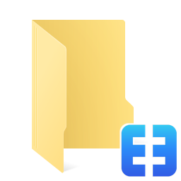

# Suigc Explorer++ Fork

This fork combines breadcrumb navigation, Simplified Chinese support, local integration fixes, and a custom icon in the Windows x64 build 1.5.0.60003. Download the portable package from [this fork's releases](https://github.com/Suigc/explorerplusplus/releases). The upstream project is [derceg/explorerplusplus](https://github.com/derceg/explorerplusplus).

## Included Changes

- The address bar sits below the tabs, with back, forward, up, and refresh buttons. Click a breadcrumb to navigate, or click the blank area / press Alt+D or Ctrl+L to edit the path. Overflow ancestors appear in a menu.
- The Simplified Chinese resource DLL is built and packaged with the application. Navigation labels, tab tooltips, and remaining untranslated text have been updated.
- File-selection requests are forwarded to the existing process, with absolute paths resolved in the sender's working directory. Requested tabs are activated and selected files are retained.
- Shell selection requests are deferred out of synchronous IPC processing so that new tabs can register with the Windows Shell.
- Newly created startup tabs use the configured default view and column layout. Restored tabs preserve their saved settings.
- Minimized or temporarily narrow layouts preserve the preferred folders pane width.
- The application icon uses a Windows yellow folder with the original blue Explorer++ logo in the bottom-right corner. Eight sizes from 16px to 256px are rendered separately.



## Build and Test

Follow [BUILDING.md](BUILDING.md) to install the prerequisites, clone with submodules, and bootstrap vcpkg. Then run:

```powershell
.\Build-Local.ps1
```

The script locates Visual Studio through vswhere, builds x64 Release and the matching Chinese translation DLL, and runs the focused address bar, main toolbar, main rebar, ProcessManager, and SessionRestorer tests. The validated toolset is MSVC 14.44.35207 with Visual Studio 2022; use -VCToolsVersion and -MSBuildPath to override. -BuildNumber defaults to 60003. -SkipDependencyInstall reuses already-installed dependencies.

The executable is produced at Explorer++/Explorer++/x64/Release/Explorer++.exe. Building from this checkout embeds the checked-in custom icon directly; no executable patching is required.

The local build also compiles the Simplified Chinese resources in `Translations/Explorer++ZH_CN` and copies `Explorer++ZH_CN.dll` beside the executable. Keep both files together when deploying: the translation DLL must have exactly the same product version as the executable. Select Simplified Chinese in Tools > Options > General > Language, then restart Explorer++ to apply it. The breadcrumb navigation buttons use the same translated labels as the main toolbar.

## Recreate the Icon

The original Explorer++ mark is retained at tools/icons/explorerplusplus-original.ico. The folder artwork is sourced from Windows stock resources; Microsoft retains rights to that artwork. This fork's appearance customization is separate from the upstream project's branding.

On Windows 10 or later, export the local stock folder icon, then run the generator with Python and Pillow installed:

```powershell
.\tools\export_windows_folder_icon.ps1 -OutputPath "$env:TEMP\explorerpp-folder.ico"
python .\tools\create_badged_icon.py --folder "$env:TEMP\explorerpp-folder.ico" --output '.\Explorer++\Explorer++\res\Explorer++.ico' --preview '.\Documentation\User\Images\ForkIcon.png'
```

The generator verifies the saved sizes and pixels against the rendered frames. Windows versions may supply different stock folder artwork. Both input icons can be replaced with other ICO files via --folder and --badge.

## Settings and Validation

Details view, hidden Size columns, foreground tabs, single-instance mode, and folder-size calculation are user settings. Existing registry or portable XML settings continue to control those preferences; machine-specific sessions and registry exports are not part of this repository.

All 50 focused regression tests pass. The Chinese DLL was checked for all 699 string resources, formatting placeholders, and 32 dialogs, and loaded successfully from a 64-bit process. Local runtime checks also covered Visual Studio file selection, Sublime file reveal, startup column widths, and foreground tabs. An older restored Downloads tab once failed native Shell matching until a fresh tab was opened for the same folder; that additional saved-tab matching issue remains unresolved. The minimized-window change has source coverage but was not reliably reproduced with the local UI automation helper. Automated visual verification of the Chinese interface was blocked by a desktop access error.

The IDEA plugin and the UE4 engine-side ExploreFolder change are separate integrations outside this Explorer++ source tree.
