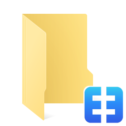

# Explorer++ Suigc 定制版



轻量级 Windows 多标签文件管理器，基于 [derceg/explorerplusplus](https://github.com/derceg/explorerplusplus)。此分支针对日常开发中的目录跳转、外部程序定位文件和界面布局做了改进，并提供简体中文语言包。

This fork of Explorer++ adds breadcrumb navigation, Simplified Chinese support, and file-selection and layout fixes. See [FORK.md](FORK.md) for technical details in English.

## 下载

[下载 1.5.0.60003 Windows x64 便携版](https://github.com/Suigc/explorerplusplus/releases/tag/v1.5.0.60003) · [所有发布版本](https://github.com/Suigc/explorerplusplus/releases)

在发布页的 Assets 中下载 `ExplorerPP-Suigc-1.5.0.60003-win-x64.zip`，解压后运行 `Explorer++.exe`，无需安装。本定制版本基于上游 1.5.0 开发代码，按预发布版提供。

压缩包包含 `Explorer++.exe`、同版本的 `Explorer++ZH_CN.dll`、说明文件及许可证。请将 EXE 和语言包 DLL 保持在同一目录；不同版本的语言包不能混用。发布页另附 SHA-256 校验文件。

### 升级与中文界面

1. 关闭正在运行的 Explorer++，备份原程序及设置。
2. 将压缩包解压到原程序目录，覆盖 EXE 和中文 DLL。已有 `config.xml` 请保留；发布包不附带个人配置。
3. 在 **Tools → Options → General → Language** 中选择简体中文，点击 Apply 或 OK，再重启程序。

默认使用注册表保存设置；也可以在选项中启用便携模式，将设置保存为 `config.xml`。

## 此版本的改进

- **面包屑地址栏**：地址栏位于标签页下方，左侧提供后退、前进、上一级、刷新按钮。
- **快速目录跳转**：点击路径中的任一级目录即可跳转；路径过长时，隐藏的上级目录收纳在菜单中。
- **路径编辑**：点击地址栏空白处，或按 `Alt+D` / `Ctrl+L` 输入路径；按 Enter 跳转，Esc 返回面包屑显示。
- **简体中文**：提供与程序一起构建的中文语言包，补齐标签提示等文本，并统一导航用语。
- **外部程序定位文件**：修复单实例转发、标签激活和文件选中处理，改善使用系统 Shell 接口定位文件时的行为。
- **布局与默认视图**：新建标签使用配置的默认视图和列布局，恢复的标签保留已保存设置；修复最小化或窗口变窄时左侧文件夹栏宽度被错误保存的问题。
- **定制图标**：黄色文件夹主体，右下角保留 Explorer++ 原图标标识。

IDEA 插件和 UE4 引擎侧的目录跳转修改属于独立集成，不包含在此发布包中。显式调用系统 `explorer.exe` 的第三方程序仍可能需要单独配置或修改。

## 原有功能

- 多标签浏览、书签和快捷键。
- 列表、详细信息、图标、缩略图等视图，以及可自定义的列布局。
- 文件搜索、筛选、拖放和文件预览。
- 批量重命名、文件拆分与合并、文件日期和属性修改、目录列表导出。
- 注册表或 XML 配置存储。

详细功能文档见 [上游用户手册](https://explorerplusplus.readthedocs.io/en/latest/)。

## 本地构建

按 [BUILDING.md](BUILDING.md) 安装 Visual Studio C++ 工具链、Windows SDK，并初始化 vcpkg，然后执行：

```powershell
.\Build-Local.ps1 -BuildNumber 60003
```

脚本构建 x64 Release 程序及匹配的简体中文 DLL，并运行地址栏、工具栏、单实例和会话恢复相关回归测试。输出目录为 `Explorer++/Explorer++/x64/Release/`。两个功能及此前修复的相关测试共 50 项已通过，中文资源检查覆盖 699 条文本和 32 个对话框。

工具链参数、图标生成和已知限制见 [FORK.md](FORK.md)。简体中文资源位于 [Translations/Explorer++ZH_CN](Translations/Explorer++ZH_CN)，上游翻译协作使用 [Crowdin](https://crowdin.com/project/explorerplusplus)。

## 许可证与致谢

Explorer++ 由 David Erceg 及其他贡献者开发，使用 [GNU GPL v3](LICENSE) 发布。此仓库保留上游代码和署名；本定制版不属于上游官方发行版。第三方库与图标来源可在程序的“关于 → 第三方致谢”中查看，定制图标的来源说明见 [FORK.md](FORK.md#recreate-the-icon)。
